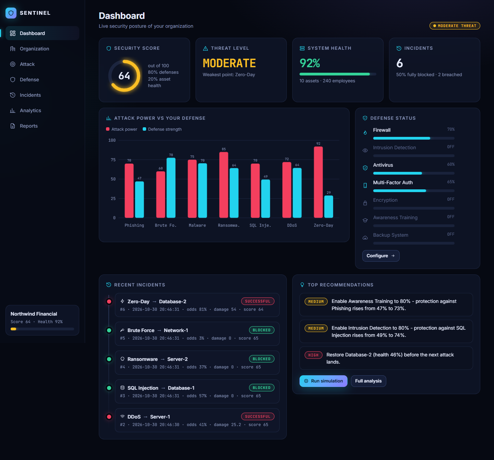
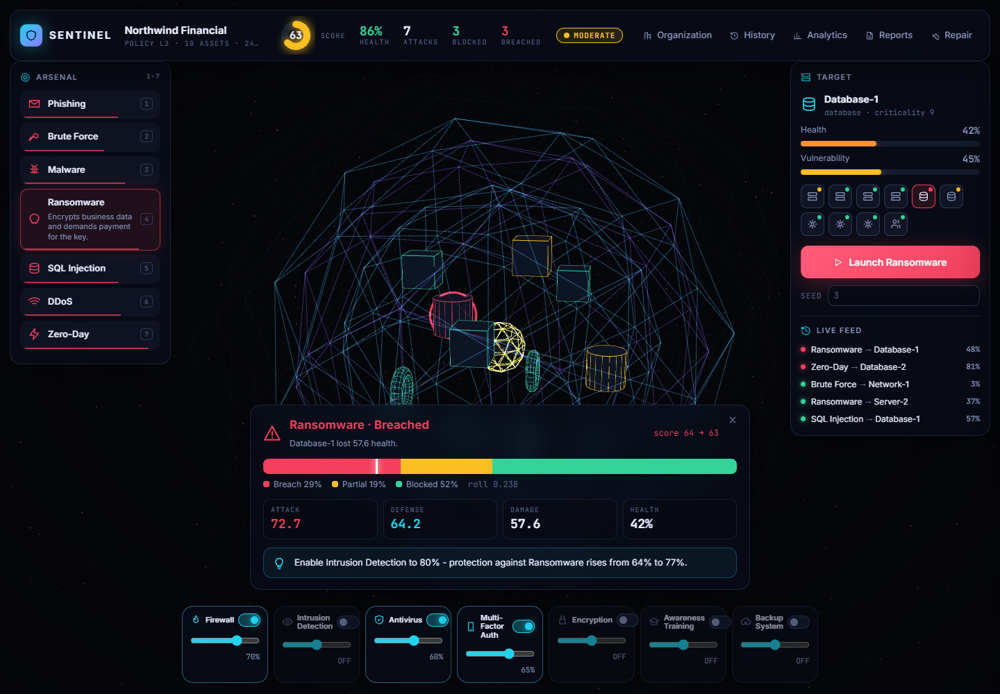
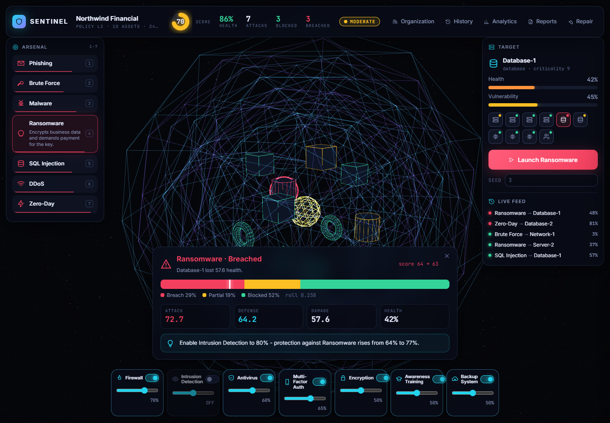
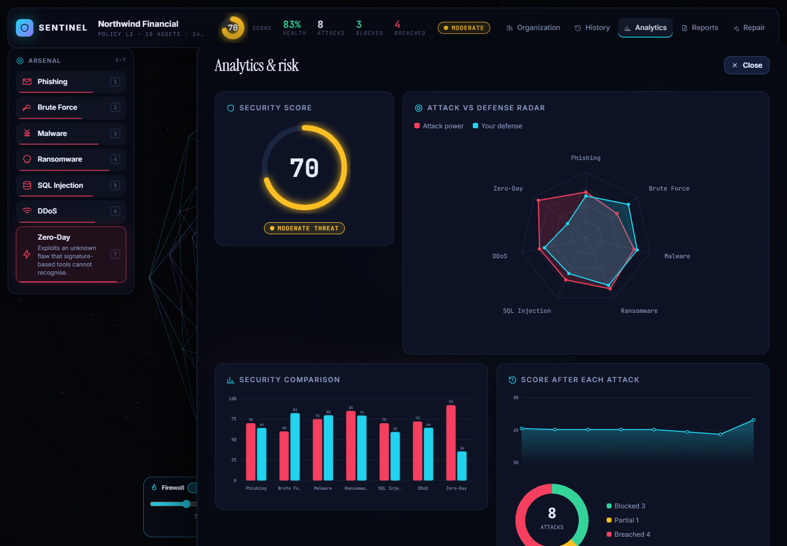
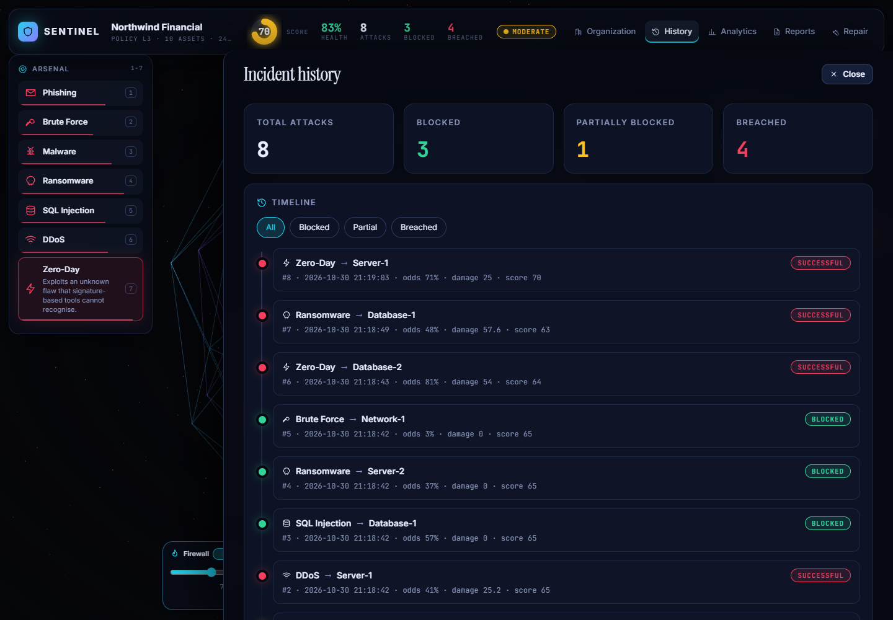
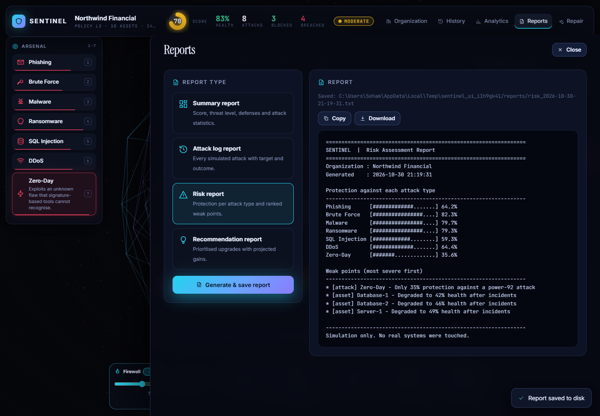
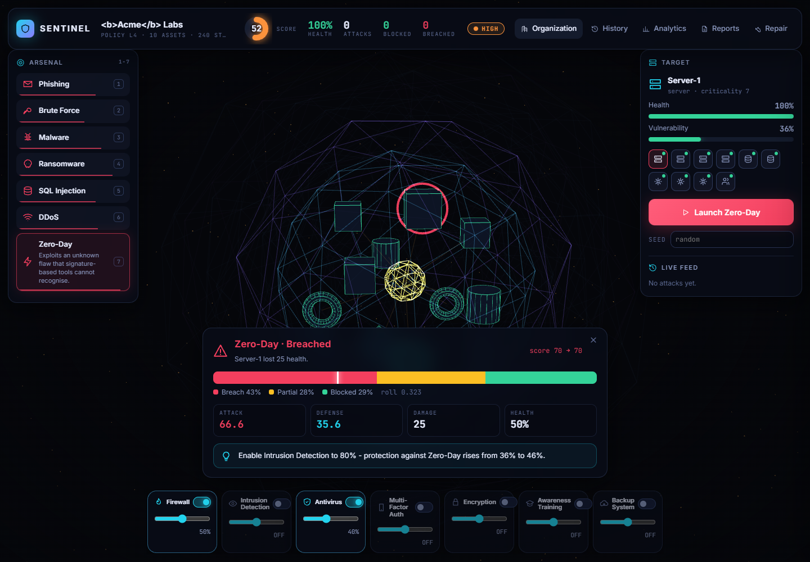

# Sentinel: Cyber Attack & Defense Simulation Platform

A safe, educational simulator. You build a virtual organization, stack security defenses, launch simulated cyberattacks, and see exactly why each attack was blocked or succeeded. **Nothing here touches a real system. It is arithmetic and pictures, not hacking.**

The simulation logic is written in **C++ (object-oriented)**. A small **FastAPI** layer exposes it over HTTP/JSON, and a dark SOC-style **web dashboard** displays the results. It was built as a C++ OOP course project; `OOP_Mapping.md` shows where every syllabus topic lives in the code.



## Features

- **Organization setup:** name, security policy level (1-5), employees, servers, databases, network devices.
- **7 attack types:** phishing, brute force, malware, ransomware, SQL injection, DDoS, zero-day. Each one has its own strength, damage, attack path, and weak and strong targets.
- **7 defenses:** firewall, IDS, antivirus, MFA, encryption, awareness training, backup system. Each can be switched on and tuned from 0 to 100%.
- **Simulation engine:** attack strength vs. combined defense gives a success probability, then a seeded dice roll gives *blocked*, *partially blocked* or *successful*. Targets take damage and lose health.
- **Risk analyzer:** security score (0-100), threat level (LOW / MODERATE / HIGH / CRITICAL), ranked weak points.
- **Recommendation engine:** tries each defense upgrade on a copy of your organization and tells you which one helps most, with the before and after numbers.
- **Cinematic landing page:** a WebGL (Three.js) scrollytelling story. One GPU particle field morphs with scroll from drifting dust, to attack streams, to a layered shield, to a single red breach, to a calm verdict.
- **Immersive command center:** the organization is a live 3D model. Drag to orbit, scroll to zoom, click a node to target it. Assets are nodes (colored by health), each defense is a glowing shield shell, and every attack flies in as a projectile that is stopped at a shell, partly stopped, or breaks through. Defense toggles and sliders apply instantly and the shells react live. Keys `1`-`7` pick an attack, `Space` launches, `Esc` closes panels.
- **Visuals:** animated attack path, odds-and-roll bar, attack-vs-defense bar chart and radar, score ring, incident timeline, score trend, outcome donut.
- **File handling:** organization config, attack history, statistics and text reports are all saved to disk by the C++ engine.
- **4 report types:** summary, attack log, risk, recommendations.

## Tech stack

| Layer | Technology |
|---|---|
| Simulation core | C++17, standard library only (no third-party code) |
| API bridge | Python 3.10+, FastAPI, uvicorn |
| Frontend | HTML, CSS, vanilla JavaScript, inline SVG charts, Three.js r160 (vendored in `web/vendor/`, no CDN script) for the landing scene |
| Data exchange | JSON |
| Persistence | Plain text files written by C++ `fstream` |

## Installation

You need: a C++17 compiler (`g++` / MinGW-w64 / clang) and Python 3.10+.

```bash
pip install -r backend/requirements.txt
```

### 1. Build the C++ engine (and run its tests)

Windows: `.\build.bat` (PowerShell) or `build.bat` (cmd)  Linux/macOS: `./build.sh`

Or by hand:

```bash
cd engine
g++ -std=c++17 -O2 -Wall -Wextra -Iinclude src/main.cpp src/Reports.cpp -o sentinel_engine
g++ -std=c++17 -O2 -Iinclude tests/test_engine.cpp src/Reports.cpp -o test_engine && ./test_engine
```

You should see `All engine tests passed.`

### 2. Start the backend (this also serves the frontend)

Windows: `.
un.bat`  Linux/macOS: `./run.sh`

or `python -m uvicorn backend.main:app --port 8000`

### 3. Open the app

Go to **http://127.0.0.1:8000**. Scroll the landing story, then click **Load demo organization** to enter the command center with a populated organization.

### Using the C++ engine on its own (no web)

The engine is a command-line program. Each command prints one JSON object.

```bash
cd engine
./sentinel_engine create-org data=../data name="My Corp" level=3 employees=100 servers=3 databases=2 devices=3
./sentinel_engine configure-defense data=../data defenses=firewall:1:80,mfa:1:70
./sentinel_engine launch-attack data=../data attack=sqli target=Database-1 seed=42
./sentinel_engine analyze-risk data=../data
./sentinel_engine generate-report data=../data type=risk
./sentinel_engine history data=../data limit=10
```

To explore the ready-made sample organization, add `data=../sample_data`. Real output samples are in `examples/`.

## API endpoints

| Method | Path | Purpose |
|---|---|---|
| POST | `/create-organization` | Create the organization with assets and starter defenses (clears history) |
| POST | `/configure-defense` | Enable/disable defenses and set their levels |
| POST | `/launch-attack` | Run one simulated attack: `{attack, target, seed?}` |
| GET | `/analyze-risk` | Score, threat level, weak points, recommendations |
| POST | `/generate-report` | `{type: summary\|attacks\|risk\|recommendations}`; saves a file and returns the text |
| GET | `/history?limit=N` | Incident list (newest first) and statistics |
| GET | `/state` | Everything the dashboard needs (`organization: null` before first setup) |
| POST | `/repair` | Restore all assets to full health |

Interactive API docs: **http://127.0.0.1:8000/docs**.

## Sample workflow

1. **Organization** (top bar, opens a drawer): deploy "Northwind Financial" at policy level 3. The starting score is mediocre because only the firewall and antivirus are on.
2. **Attack:** pick *Phishing* in the arsenal (left), click `Employee-Workstations` in the 3D scene or the target chips (right), press **Launch**. It probably succeeds, since nothing protects people. The recommendation panel says *Enable Awareness Training*.
3. **Defense:** flip Awareness Training and MFA on in the dock (bottom) or press **Apply** on the result card. Changes save instantly and the score rises.
4. **Attack again:** same attack and same seed. The odds drop and the outcome changes.
5. **Analytics:** the radar shows the remaining gap (zero-day is always the hardest).
6. **Reports:** generate the recommendation report; it is saved under `data/reports/`.

## How the simulation works

```
attack strength  = attack power x asset exposure to that attack x (0.5 + asset vulnerability)      (capped at 100)
defense strength = 100 x (1 - product of every layer's gap) x (1 - attack bypass)
                   layers: security-policy baseline (4 x level) + each enabled defense (level x its coverage of that attack)
probability      = clamp(0.4 + (attack strength - defense strength) / 100, 3%, 97%)
roll in [0,1):   roll < 0.6 x probability -> SUCCESSFUL,  roll < probability -> PARTIALLY_BLOCKED,  else BLOCKED
damage           = 4 x criticality x attack damage factor x (1 - backup/encryption mitigation)   (1/3 if partial)
security score   = 0.8 x average defense across all 7 attacks + 0.2 x average asset health
threat level     = LOW >= 80, MODERATE >= 60, HIGH >= 40, else CRITICAL
```

The numbers are a teaching model, not measured security data. Zero-day and phishing *bypass* part of the defenses (no signature exists / the target is a person), which is why training and layered defenses matter.

## File structure

```
Sentinel/
├── README.md, OOP_Mapping.md
├── build.bat / build.sh        build the engine + run C++ tests
├── run.bat / run.sh            start the web app
├── engine/                     C++ simulation core
│   ├── include/                Asset, Attack, Defense, Organization, SimulationEngine,
│   │                           RiskAnalyzer, RecommendationEngine, FileManager, Incident,
│   │                           IncidentHistory, Reports, Exceptions, Interfaces, Util
│   ├── src/main.cpp            command-line entry point (JSON out)
│   ├── src/Reports.cpp         report classes
│   ├── tests/test_engine.cpp   self-checking C++ tests
│   └── Makefile
├── backend/
│   ├── main.py                 FastAPI bridge to the engine
│   ├── test_api.py             API tests against the real engine
│   ├── test_ui.py              browser end-to-end test (Playwright), makes the screenshots
│   └── make_samples.py         regenerates sample_data/ and examples/
├── web/                        index.html, style.css, ui.js (icons + charts), story.js (WebGL landing),
│                               console.js (3D command center + HUD), app.js (router, drawer screens),
│                               vendor/three.min.js
├── sample_data/                a ready-made organization + history in the engine's file format
├── examples/                   real JSON responses and the four report types
├── docs/screenshots/
└── data/                       created at run time (org.cfg, history.log, stats.txt, reports/)
```

### Data files (written by C++)

| File | Content |
|---|---|
| `org.cfg` | `org\|name\|level\|employees`, then `asset\|type\|name\|criticality\|vulnerability\|health` and `defense\|key\|enabled\|level` lines |
| `history.log` | one incident per line, appended after every attack |
| `stats.txt` | totals and last security score, rewritten after every attack |
| `reports/` | timestamped text reports |

Set `SENTINEL_DATA` to use a different data folder (for example `sample_data`).

## Testing

```bash
.\build.bat                       # C++ unit-style tests
python backend/test_api.py        # API + engine end to end
pip install playwright && playwright install chromium
python backend/test_ui.py         # clicks through every screen, fails on any JS error
```

## Screenshots

| | |
|---|---|
|  |  |
|  |  |
|  |  |

## Known limits

- The landing scene needs WebGL; without it the page falls back to the plain dark background and text.
- Fonts (Instrument Serif, Inter, JetBrains Mono) load from Google Fonts; offline they fall back to system fonts.
- The backend runs one engine call at a time (a global lock) and keeps one organization per data folder.
- Names may not contain `|` (it is the file separator); the engine rejects them.
- Probabilities are a simple model for teaching, not a risk-assessment tool.

## Future scope

Multiple organizations and user accounts, network topology graph with lateral movement, attack chains (phishing then ransomware), scenario files, time-based incident response, exportable PDF reports, a score-over-time dashboard across sessions.
